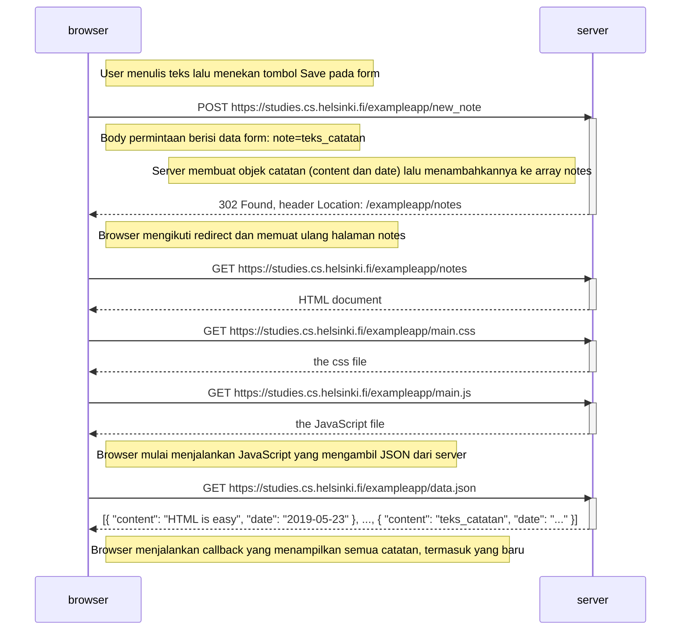

# 0.4: New note diagram

Pengguna membuka https://studies.cs.helsinki.fi/exampleapp/notes, menulis teks pada kolom input, lalu menekan **Save**.
Form pada halaman memakai `action='/exampleapp/new_note'` dan `method='POST'`, sehingga browser mengirim permintaan
POST biasa dan memuat ulang halaman (aplikasi web tradisional).

