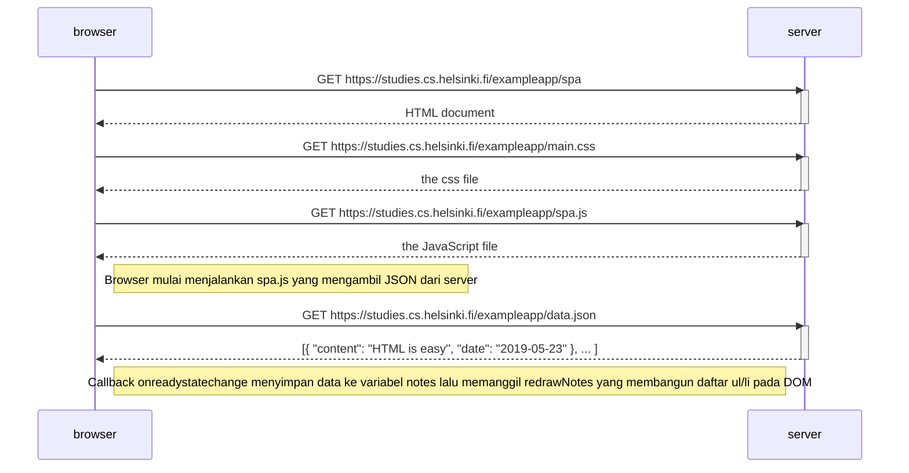

# 0.5: Single page app diagram

Pengguna membuka versi single page app (SPA) di https://studies.cs.helsinki.fi/exampleapp/spa.
Halaman HTML-nya hanya satu; pembuatan daftar catatan dilakukan oleh JavaScript di browser.

