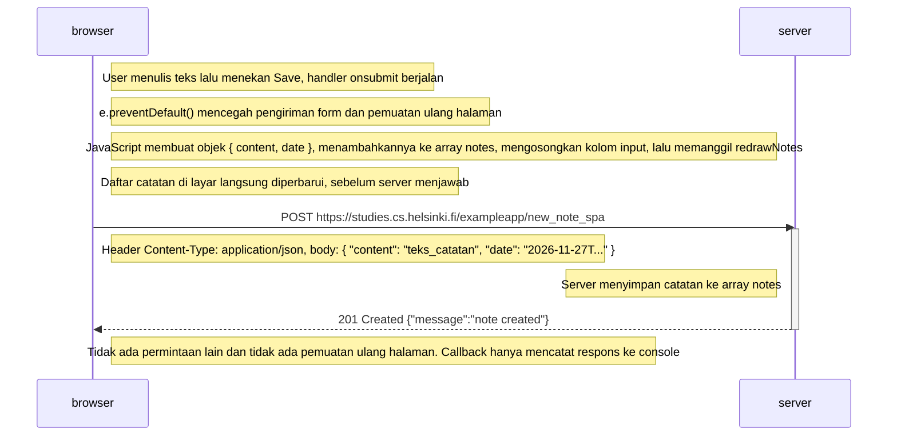

# 0.6: New note in Single page app diagram

Pada versi SPA, handler `onsubmit` milik form memanggil `e.preventDefault()` sehingga browser tidak mengirim form
dan tidak memuat ulang halaman. JavaScript menambahkan catatan baru ke daftar lokal, menggambar ulang daftar,
lalu mengirim catatan itu ke server sebagai JSON.

